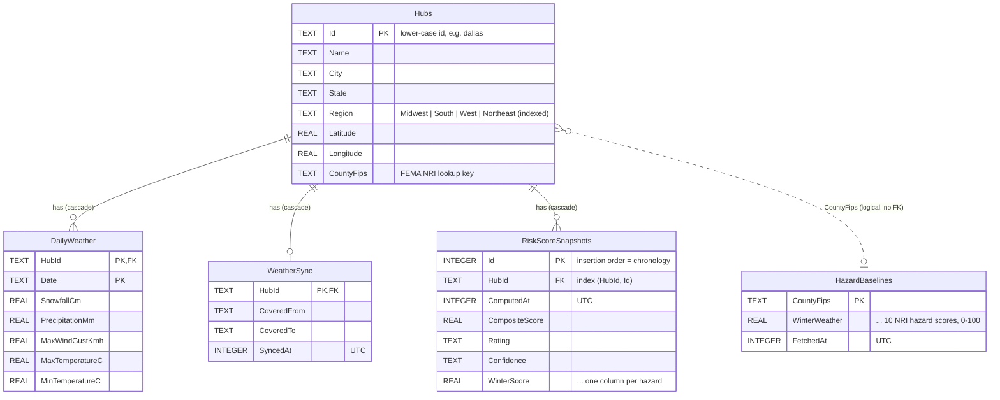
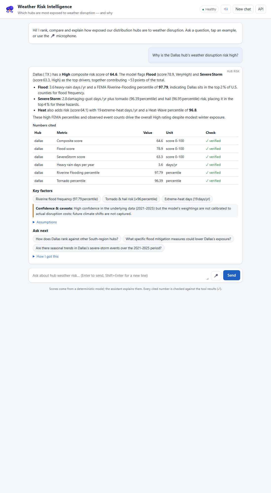

# Weather Risk Intelligence Agent — Design & Architecture

> Living document: updated in every task branch. Sections marked *TBD* are filled in by the task noted.

## 1. Problem & scope
A logistics company runs regional distribution hubs across the US. Severe weather shuts hubs down and
costs money; each year a handful of hubs get resilience investment. This system is an AI agent that helps
analysts **rank, compare, and explain hub exposure to weather disruption**, conversationally.

**In scope:** 15 US hubs, four hazard categories (winter, hurricane/wind, flood, heat), historical weather
statistics, a deterministic risk score, an LLM agent that uses that score as tools, chat UI with voice,
evaluation set, monitoring, and (bonus) risk-change alerts.

**Out of scope:** real company hub data, financial loss modelling, forecasting, authentication / multi-tenant.

## 2. System architecture
```
 Browser (static HTML/JS chat + voice)
        │  HTTP/JSON
        ▼
 ┌──────────────────────── WeatherRisk.Api (ASP.NET Core, single process) ────────────────────────┐
 │  Middleware: metrics · rate limiting · ProblemDetails          Swagger UI (/swagger)            │
 │  Endpoints: /api/chat · /api/hubs · /api/scores · /api/system/* · /api/alerts                   │
 │                                                                                                 │
 │  Agent ── LLM provider chain (Groq → Gemini) ── JSON-schema validation                          │
 │    │ tool calls                                                                                 │
 │    ▼                                                                                            │
 │  Core: scoring engine (per-hazard strategies → weighted composite), ranking, comparison         │
 │    │                                                                                            │
 │  Data: repositories (EF Core) ── SQLite file   ·   API clients (resilient HttpClient) + cache   │
 │  Background: score recompute scheduler → change detection → alert notifiers (bonus)             │
 └─────────────────────────────────────────────────────────────────────────────────────────────────┘
        │ HTTPS                                   │ HTTPS
        ▼                                         ▼
 Open-Meteo Historical API, FEMA NRI       LLM APIs (Groq / Gemini, OpenAI-compatible)
```
### Layers
| Layer | Project | Responsibility |
|---|---|---|
| HTTP / composition | `WeatherRisk.Api` | Endpoints (thin), contracts + mapping, middleware, DI wiring, background services |
| Application | `WeatherRisk.Core/Application` | `HubRiskService` use cases: assess, rank, compare, weather statistics — shared by REST endpoints and (task 7) the LLM agent's tools |
| Domain | `WeatherRisk.Core` | Scoring engine, hazard strategies, ranking, statistics, repository/data-source ports |
| Infrastructure | `WeatherRisk.Data` | SQLite repositories, Open-Meteo/FEMA clients, cache-first provider |

Request flow for `GET /api/hubs/dallas/risk`:
```
HubEndpoints.GetRiskAsync → HubRiskService.AssessAsync
   → IHubRepository (hub) → IHubDataProvider (baseline + weather: cache-first)
   → WeatherStatisticsCalculator (window summary) → RiskScoringEngine (5 IHazardScorer strategies)
   → freshness notes → ContractMapper → JSON (enums as names)
```

### API endpoints
| Method & route | Purpose | Brief question it answers |
|---|---|---|
| `GET /api/hubs?region=` | List hubs | — |
| `GET /api/hubs/{id}` | One hub | — |
| `GET /api/hubs/{id}/risk` | Composite + per-hazard breakdown, contributions, evidence, provenance | "Why is the Dallas hub's risk high?" |
| `GET /api/hubs/{id}/weather?from=&to=` | Disruption-day counts, % of days, per-year, totals (default: last full year) | "What % of days in Denver last year had snowfall?" |
| `GET /api/risk/rankings?region=&hazard=&top=` | Rank by composite or hazard | "Which Midwest hubs are most exposed to winter?" |
| `GET /api/risk/compare?hubs=a,b&hazards=` | Side-by-side rows + full breakdowns | "Compare Miami and Houston for hurricane and flood" |
| `GET /api/risk/model` | Live description of the model (weights, thresholds, bands, assumptions) | "How is the score calculated?" |
| `POST /api/chat` | Conversational agent (§7): any of the above in natural language, with follow-ups | All of them |
| `GET /api/system/health · metrics · schema` | Operations (task 2/4/5) | — |

Errors are RFC 7807 ProblemDetails: unknown hub → 404 (`unknownHubs` extension), invalid enum/date/period/top → 400.
Score history endpoints arrive with the scheduler that records snapshots (task 10).

## 3. Repository structure
```
WeatherRisk.slnx                 Solution (new XML format, opens in Visual Studio 2026)
Directory.Build.props            Shared settings: net10.0, nullable, XML docs (missing docs = build error)
Directory.Packages.props         Central NuGet versions
global.json                      SDK pin + Microsoft Testing Platform runner
src/
  WeatherRisk.Api/               Composition root (ASP.NET Core Minimal API)
    Program.cs                   DI registration + middleware pipeline
    Endpoints/                   Endpoint groups: System, Hubs, Risk, Chat (one static class per resource)
    Contracts/                   Records per area (System, Hubs, Risk, Chat) + mappers
    Risk/                        Risk-model DI registration
    Agent/                       Agent DI registration, in-memory conversation store
    Errors/                      DomainExceptionHandler (domain exceptions → 404/400 ProblemDetails)
    Observability/               Request + dependency metrics, health checks
    RateLimiting/                Rate-limiter configuration
    Persistence/                 SQLite path resolution, schema describer
    Background/                  Hosted services (data warm-up)
    ChatUi/                      Static UI hosting (default files, security headers)
    wwwroot/                     Chat UI: index.html, css/app.css, js/{app,markdown,format,voice}.js
  WeatherRisk.Core/              Domain + scoring logic (no infrastructure dependencies)
    Domain/                      Hub, Region, HazardType
    Weather/                     DailyWeather, WeatherSummary, thresholds, statistics calculator
    Scoring/                     Engine, settings, results, IHazardScorer
      Hazards/                   One scorer per hazard + shared HazardMath
    Ranking/                     HubRanker (rank + compare)
    Abstractions/                Ports implemented by Data: repositories, data sources, data provider
    Application/                 HubRiskService (use cases), RiskModelDescriber, result records, domain exceptions
    Agent/                       ChatAgent loop, AgentAnswer contract, AnswerValidator, prompt, memory port
      Llm/                       ILlmClient port (provider-neutral messages, tools, completions)
      Tools/                     AgentTool<TArgs> base + 6 tools over HubRiskService
  WeatherRisk.Eval/              Black-box evaluation runner (HTTP only) + eval-cases.json
  WeatherRisk.Data/              EF Core/SQLite persistence + external API clients
    Persistence/
      Entities/                  EF entities (one per table)
      Configurations/            Fluent schema config incl. comments, keys, indexes
      Repositories/              Repository implementations (internal)
      Seed/HubCatalog.cs         The 15 hubs
      Migrations/                Generated EF migrations
    External/
      OpenMeteo/                 Typed client + response DTOs (source-generated JSON)
      Fema/                      Typed client, DTOs, percentile calculator
      HubDataProvider.cs         Cache-first provider with fallbacks
      Llm/                       OpenAI-compatible client, fallback chain, settings, wire DTOs
tests/
  WeatherRisk.Api.Tests/         Endpoint tests (WebApplicationFactory, temp SQLite file) + Api unit tests
  WeatherRisk.Core.Tests/        Golden-value unit tests for statistics, scorers, engine, ranking
  WeatherRisk.Data.Tests/        Repository + schema tests on in-memory SQLite with real migrations
  WeatherRisk.Eval.Tests/        JSON path, check evaluators, suite validation, report (canned JSON)
  ui/                            Node built-in test runner tests for the UI's pure JS (markdown, format)
docs/evaluation/                 Latest committed evaluation report (Markdown + JSON)
docs/images/                     UI screenshots
dotnet-tools.json                Local tools (dotnet-ef) — `dotnet tool restore`
.editorconfig                    Formatting; exempts generated migrations from the XML-doc rule
docs/                            Architecture, plan, session transcript
.claude/skills/                  Engineering standards the AI agent must follow
```
**Dependency rule:** `Api → Core ← Data` (Api also references Data for DI wiring). Core references nothing.

## 4. Data storage
**Choice: SQLite (single file, EF Core).**
- Zero install, runs on a laptop, file can ship with the demo; real SQL with indexes and transactions.
- Data volume is small (15 hubs × a few years of daily aggregates, cached API payloads, score history).
- Swap path: EF Core makes moving to PostgreSQL a provider/connection-string change.
- File: `src/WeatherRisk.Api/App_Data/weatherrisk.db` (git-ignored). Created and migrated automatically on
  startup; safe to delete — it is a cache plus score history and will be rebuilt.
- **WAL mode** is enabled so the background scorer (task 10) can write while API requests read.

### Schema
Live description (columns, types, keys, indexes, comments): **`GET /api/system/schema`** — generated at
runtime from the EF Core model, so it cannot drift from the code. Every table and column carries a comment
(enforced by a unit test).



| Table | Role | Write pattern |
|---|---|---|
| `Hubs` | Reference data, seeded by the initial migration from `HubCatalog` | Migration only |
| `DailyWeather` | Cache of Open-Meteo daily rows (~1,830 per hub for 5 years) | Atomic range replace (set-based delete + batched insert in one transaction) |
| `WeatherSync` | Cache freshness: period + fetch time per hub | Written in the same transaction as `DailyWeather` |
| `HazardBaselines` | Cache of FEMA NRI scores per county | Upsert |
| `RiskScoreSnapshots` | Append-only score history for trends and change alerts | Batched append |

### Data access design
- **Repository pattern with ports in Core:** `IHubRepository`, `IWeatherRepository`,
  `IHazardBaselineRepository`, `IRiskScoreHistoryRepository` are defined in `WeatherRisk.Core/Abstractions`
  and implemented (internally) in `WeatherRisk.Data` — Core never references EF (Dependency Inversion).
  Small, separate interfaces (Interface Segregation) rather than one generic repository.
- **Entities ≠ domain models:** EF entities live in Data and are mapped to Core records; neither is exposed
  over the API (API contracts are separate records).
- **Performance:** pooled `DbContext`; `AsNoTracking` + projection for reads; composite PK `(HubId, Date)`
  serves the range query; `(HubId, Id)` index serves latest/history; change tracker cleared after bulk writes.
- **Migrations** (EF Core, `dotnet-ef` as a local repo tool) are applied at startup; a unit test fails if the
  model changes without a new migration.

## 5. Data sources
| Source | Used for | Auth |
|---|---|---|
| Open-Meteo Historical Weather API | Daily snowfall, precipitation, wind, temperature per hub | None (free) |
| FEMA National Risk Index | County-level hazard frequency (winter, ice, cold, hurricane, inland/coastal flood, tornado, hail, wind, heat) | None (free) |
| Groq (primary) / Gemini (fallback) | LLM for tool routing and explanations | Free-tier API key (user-secrets) |

### Open-Meteo (`OpenMeteoClient`)
`GET archive-api.open-meteo.com/v1/archive` with `daily=snowfall_sum,precipitation_sum,wind_gusts_10m_max,
temperature_2m_max,temperature_2m_min&timezone=auto` for the hub's coordinates over the window
(last 5 full calendar years, e.g. 2021–2025). Units are already cm / mm / km/h / °C. One request per hub
(~1,826 rows). Response arrays are validated for alignment; coordinates are formatted culture-invariant.

### FEMA NRI (`FemaNriClient`)
Public ArcGIS feature service `National_Risk_Index_Counties` (NRI release "December 2025" at time of writing).
**Design change found during integration:** NRI's *Risk Index Score* scales with a county's population and
property value, so every large metro county scores ~95–100 on nearly every hazard (Miami-Dade = 99.5 for
*cold wave*) — useless for comparing metro hubs. We therefore use **annualized frequency (`*_AFREQ`)** —
how often the hazard occurs, independent of what is built there — and convert it to a **national percentile
among all 3,232 counties** (mid-rank, per hazard). One paged download (2 × 2,000 rows) serves all hubs and is
cached for 30 days. Null frequency = hazard not applicable to the county (kept null).
FEMA renamed "Riverine Flooding" to **Inland Flooding (`IFLD`)**; it maps to `HazardBaseline.RiverineFlooding`.

### Cache-first provider (`HubDataProvider`, implements Core's `IHubDataProvider`)
```
for each hub: cache covers window and younger than TTL? ── yes ──► Cached (no network)
                                    │ no
                                    ▼
              fetch live (≤ 4 in parallel; DB writes stay sequential — DbContext isn't thread-safe)
                 │ success                        │ failure (after retries / timeout / open circuit)
                 ▼                                ▼
     atomic replace in SQLite → Fresh     old cache? ── yes ──► Stale (+ fallback counted & logged)
                                                    └─ no ───► Unavailable
```
Every result carries its `DataFreshness` and retrieval time, which feeds the confidence/notes shown to users.
A background **warm-up** (`DataWarmupService`) fills the cache at startup so the first question is answered
from SQLite (cold fetch of 15 hubs ≈ 50 s due to Open-Meteo's minute quota; cached ≈ 80 ms).

## 6. Risk scoring model (deterministic)

The score is a **transparent, rule-based risk index** — not a trained ML model. The LLM never computes scores;
it calls tools that run this model. No company disruption history was available to train or calibrate on,
so the parameters below are documented expert assumptions, all overridable via configuration
(`ScoringSettings`, `WeatherThresholds`).

### Two signals per hazard
| Signal | Source | Why |
|---|---|---|
| **Observed** | Open-Meteo daily history, last 5 full years | What actually happened recently at the hub's coordinates |
| **Baseline** | FEMA National Risk Index, hub's county: annualized hazard **frequency** as a national percentile (0–100) | Decades of hazard history; captures rare events (landfalls, tornadoes) that 5 years can miss |

`hazardScore = w_obs × observed + (1 − w_obs) × baseline` — if one signal is missing, the other is used alone.
If FEMA rates a hazard **not applicable** to the county (baseline present, all its components null — e.g.
hurricanes in Denver), the hazard scores **0** with a `notApplicable` evidence factor: weather proxies never
override FEMA's applicability.

### Hazards
| Hazard | Observed: disruption day (threshold) | Cap (days/yr → 100) | NRI baseline (mean of available) | w_obs |
|---|---|---|---|---|
| Winter | 60% snow day (snowfall ≥ 1 cm) + 40% hard freeze (min ≤ −12 °C) | 40 snow / 30 freeze | Winter Weather, Ice Storm, Cold Wave | 0.60 |
| Hurricane | Gust ≥ 90 km/h (tropical-storm force) — evidence only | 3 | Hurricane | **0.00** |
| Flood | Precipitation ≥ 50 mm | 6 | Riverine Flooding, Coastal Flooding | 0.50 |
| Severe storm | Gust ≥ 75 km/h | 12 | Tornado, Hail, Strong Wind | 0.40 |
| Heat | Max temperature ≥ 38 °C | 45 | Heat Wave | 0.60 |

Observed score = `min(100, daysPerYear / cap × 100)`. `w_obs` is low where daily weather is a weak proxy
(tornadoes/hail) and high where it measures the hazard directly (snow, heat). **Hurricane `w_obs` was
lowered from 0.25 to 0 after validating on real data:** daily ≥ 90 km/h gusts also come from nor'easters
(New York) and downslope winds (Denver), so the proxy ranked New York above Miami. Gust days remain visible
as evidence and are used only if the FEMA baseline is unavailable.

### Real-data sanity check (snapshot 2026-10-20, window 2021–2025)
| Hub | Composite | Winter | Hurricane | Flood | Severe storm | Heat | Top drivers |
|---|---|---|---|---|---|---|---|
| New Orleans | 71.2 High | 7 | 95 | 76 | 29 | 36 | Hurricane, Flood |
| Miami | 70.9 High | 10 | 99 | 56 | 30 | 26 | Hurricane, Flood |
| Houston | 69.3 High | 14 | 88 | 81 | 36 | 43 | Hurricane, Flood |
| Phoenix | 68.5 High | 2 | 34 | 53 | 25 | 99 | Heat, Flood |
| Dallas | 64.6 High | 21 | 34 | 79 | 63 | 64 | Flood, Severe storm |
| Minneapolis | 55.9 High | 71 | 0 | 45 | 51 | 27 | Winter, Severe storm |
| Chicago | 49.4 Moderate | 57 | 21 | 35 | 59 | 14 | Severe storm, Winter |
| Denver | 41.4 Moderate | 56 | 0 | 21 | 35 | 8 | Winter, Severe storm |
| Seattle | 23.6 Low | 30 | 0 | 19 | 18 | 17 | Winter, Flood |

Midwest winter ranking: Minneapolis 71 > Chicago 57 > Detroit 54 > Kansas City 44 > Indianapolis 40.
Denver 2025: 17 snow days of 365 (4.7%).

### Composite
```
composite = 0.5 × worstHazard + 0.5 × Σ(wᵢ × hazardᵢ) / Σwᵢ
weights: Winter 0.25 · Hurricane 0.20 · Flood 0.20 · Severe storm 0.20 · Heat 0.15
```
The worst-hazard term prevents dilution: a hub that is extreme on one hazard (Miami/hurricanes) is
high-risk even if every other hazard is benign. **Ratings:** Low < 25 ≤ Moderate < 50 ≤ High < 75 ≤ Very High.

### Explainability & confidence
Each `HubRiskScore` carries, per hazard: score, observed and baseline parts, **evidence factors** (e.g.
`snowDaysPerYear = 18.4`, `nriHurricane = 97.2`), normalized weight and **contribution** (contributions sum
exactly to the composite), plus the **top two drivers** and data **notes**.
Confidence: **High** = full weather coverage (≥ 90% of the window) and NRI present; **Medium** = one signal
missing/incomplete; **Low** = neither.

### Components (WeatherRisk.Core)
| Component | Pattern / role |
|---|---|
| `WeatherStatisticsCalculator` | Single-pass aggregation of daily rows → `WeatherSummary` (also answers "% of snow days in Denver last year") |
| `IHazardScorer` + 5 implementations | **Strategy** — one per hazard; adding a hazard = adding a class (Open/Closed) |
| `HazardMath` | Shared normalize/blend/single-metric recipe — keeps the four single-metric scorers ~10 lines each |
| `RiskScoringEngine` | Composite, attribution, drivers, confidence; validates settings and scorer set at construction (fail fast) |
| `HubRanker` | Pure ranking (by composite or hazard, region filter, top N, deterministic tie-breaks) and side-by-side comparison |
| `ScoringSettings`, `WeatherThresholds` | Plain settings objects (Core has no dependency on `Microsoft.Extensions.Options`; the Api binds them) |

### Future calibration
With the company's historical closure/delay records, weights and caps could be fitted (e.g. regression in
ML.NET) so the index predicts real disruption days or cost — the model structure stays the same.

## 7. Agent design & structured output

**Division of labour:** the LLM decides *what to look up* and *how to explain it*; every number comes from
deterministic tools; our code validates the answer before it reaches the analyst.

```
POST /api/chat {message, conversationId?}
  └─ ChatAgent (Core/Agent) ── bounded loop (≤ 8 steps, 60 s deadline) ─────────────────────────────┐
       [system prompt + last 6 Q&A + question] → ILlmClient (tool_choice = required)               │
          ├─ tool calls → IAgentTool (6 tools over HubRiskService) → JSON results back to the LLM  │
          └─ submit_answer(args) → AnswerValidator: 1) strict schema parse  2) grounding check ────┘
  ← ChatResponse: answer, intent, findings[verified], keyFactors, assumptions, uncertainty,
                  followUpQuestions, verification, toolCalls trace, llm {provider, model, steps, tokens, ms}
```

### Tools (`Core/Agent/Tools`)
| Tool | Wraps | Used for |
|---|---|---|
| `list_hubs(region?)` | `GetHubsAsync` | Resolve names to ids |
| `rank_hubs(region?, hazard?, top?)` | `RankAsync` | "Which hubs are most exposed…" |
| `compare_hubs(hubIds[], hazards?)` | `CompareAsync` (+ compact evidence for compared hazards) | "Compare Miami and Houston…" |
| `get_hub_risk(hubId)` | `AssessAsync` (full breakdown + evidence) | "Why is Dallas high?" |
| `get_weather_statistics(hubId, from?, to?)` | `GetWeatherStatisticsAsync` | "% of days with snowfall…" |
| `describe_risk_model()` | `RiskModelDescriber` | Methodology |

`AgentTool<TArgs>` (Template Method) generates each tool's JSON schema from its argument record, parses
arguments strictly, and turns domain errors (unknown hub, period outside window) into `{"error": …}` messages
so the model can self-correct instead of failing the conversation.

### Structured output — how the JSON schema is enforced
1. **Single source of truth:** `AgentAnswer` (C# record) → `JsonSchemaExporter` → schema of the
   `submit_answer` tool (all fields required, `additionalProperties: false`, enum values, descriptions).
2. **Forced:** every request uses `tool_choice: "required"`, so the model must end with a tool call; prose
   replies get a reminder.
3. **Validated by our code:** strict `System.Text.Json` options (`UnmappedMemberHandling.Disallow`,
   `RespectRequiredConstructorParameters`, `RespectNullableAnnotations`, no numeric enums) + semantic limits
   (non-empty answer/uncertainty, ≤ 3 follow-ups). Violations are sent back to the model (≤ 2 repairs).
4. **Grounding check:** every number in `findings` must appear in a tool result from this turn (±0.05 or
   integer rounding) and every hub must have been returned by a tool. Unsupported findings are returned with
   `verified: false` and a note — the LLM can't pass off invented scores as facts.

### LLM access (`Data/External/Llm`)
- **`OpenAiCompatibleChatClient`** — our own ~150-line client for `POST /chat/completions`; one class serves
  Groq, Gemini's OpenAI endpoint and Ollama. Source-generated JSON (snake_case), key sent per request, never logged.
- **`FallbackLlmClient`** — Chain of Responsibility over (provider × model):
  **Groq gpt-oss-120b → Groq gpt-oss-20b → Groq qwen3.8-27b → Gemini (if keyed)**. Each failure is logged and
  counted as a fallback (`/api/system/metrics`); all failing → `503` with a hint to the deterministic endpoints.
- Per-provider named `HttpClient` with metrics handler + resilience (30 s attempt, 1 quick retry, **no long
  Retry-After waits** — the next model is faster than waiting out a quota).
- Groq's `tool_use_failed` (malformed tool call by the model) is retried once on the same model.

### Findings from live testing (and what was changed)
| Observation | Change |
|---|---|
| gpt-oss with `reasoning_effort: low` called a non-existent tool `json` instead of `submit_answer` (0/3 in a probe) | `medium` (3/3); prompt names the tool explicitly; same-model retry on `tool_use_failed` |
| Groq free tier: 8,000 tokens/min **per model**; a question costs ~4–6k → bursts got 429 | Three Groq models in the chain (separate quotas); `max_tokens` 2048→1500 (counted against quota); chat rate limit 10/min |
| Comparisons explained differences with invented geography ("low-lying area") | `compare_hubs` returns compact evidence; prompt requires causes from evidence fields |
| Malformed chat body returned 500 in Development | `BadHttpRequestException` → 400 ProblemDetails |

### Conversation memory
`IConversationStore` (Core) → `InMemoryConversationStore` (Api): last 10 turns per conversation, 60 min idle
expiry, max 1,000 conversations (own size-limited `MemoryCache`). Only Q&A text is kept — tool data is
re-fetched cheaply — which keeps prompts small. Swap for SQLite/Redis to survive restarts or scale out.

## 7b. Chat UI (`src/WeatherRisk.Api/wwwroot`)

A static page served by the API at `/` — **no framework, no build step, no CDN** (works offline in a demo).

| File | Responsibility |
|---|---|
| `index.html` | Layout: header (health badge, read-aloud, new chat, API link), log, example questions, composer with 🎤 |
| `js/app.js` | Controller: `POST /api/chat`, renders the structured answer, conversation id, health polling, `?q=` deep link |
| `js/markdown.js` | Safe Markdown → HTML (**escape everything first**, then add our own tags) — model output can't inject markup |
| `js/format.js` | Pure helpers (numbers, durations, health colours, ProblemDetails → message) |
| `js/voice.js` | Voice input (Web Speech API recognition) and read-aloud (speech synthesis); hidden if unsupported |
| `css/app.css` | Styling with light/dark themes |

Each answer shows: Markdown text · **"Numbers cited" table with ✓ verified / ⚠ unverified** (the grounding
check) · key factors · confidence & caveats · assumptions · clickable follow-ups · a collapsible
**"How I got this"** panel (tool calls with arguments and timings, model, steps, tokens, duration).
Errors (429/502/503) render as friendly messages, including the hint to the deterministic endpoints.

**Security:** strict Content-Security-Policy (`default-src 'self'`, no inline script/style), `nosniff`,
`no-referrer`; assets use `Cache-Control: no-cache` + ETag (not fingerprinted, so browsers revalidate).
Static files short-circuit before routing, so they don't touch API metrics or rate limits.



## 8. Monitoring, rate limiting & resilience

### Request pipeline (order matters)
```
Swagger → Routing → RequestMetrics → ExceptionHandler → StatusCodePages (ProblemDetails) → RateLimiter → Endpoint
```
Metrics run after routing (so requests are labelled by route template, e.g. `GET /api/hubs/{id}`, keeping
the number of keys bounded) and *outside* the exception handler and rate limiter, so they record the final
status of everything: handled domain exceptions as 404/400 (not 500), unhandled ones as 500, and 429s.
The route label is captured before the request proceeds because the exception handler clears the endpoint.
Domain exceptions are not logged as errors (`SuppressDiagnosticsCallback`) — they are expected outcomes.

### Request metrics — `GET /api/system/metrics`
| Field | Meaning |
|---|---|
| `total`, `succeeded`, `clientErrors`, `serverErrors`, `rateLimited` | Outcome counters since startup (429 counted separately from other 4xx — it signals load, not a client bug) |
| `requestsInWindow` | Requests in the last `windowSeconds` (default 60) — load indicator |
| `avgLatencyMs`, `p95LatencyMs`, `maxLatencyMs` | Over the last 512 requests per endpoint — bottleneck indicator |

Provided per endpoint and overall (`ALL`). Unknown `/api` routes are grouped as `(unmatched)`.
- **Implementation:** `RequestMetricsMiddleware` → `RequestMetricsCollector` (singleton) → per-endpoint
  `EndpointStats` = `SlidingWindowCounter` (60 one-second buckets) + `LatencyWindow` (ring buffer).
- **Cost:** fixed memory per endpoint, one short uncontended lock per request, no allocations on record;
  sorting for p95 happens only when metrics are read.
- In-memory by design (resets on restart). ASP.NET Core's built-in `http.server.*` meters also work with
  `dotnet-counters` for deeper inspection.

### Health — `GET /api/system/health`
ASP.NET Core health checks; 200 for Healthy/Degraded, 503 for Unhealthy. Dependency checks are added by
the features that own them (task 5: data sources, task 7: LLM).

### Rate limiting
Built-in ASP.NET Core rate limiter, **sliding window per client IP** (default 120 requests / 60 s,
6 segments) on all `/api` routes **except `/api/system/*`** — health and metrics must stay reachable under
load, which is exactly when they're needed. Rejections: `429` + `Retry-After` + ProblemDetails. Settings in
`appsettings.json` → `RateLimiting`, validated at startup. *(Task 7 adds a stricter policy for `/api/chat`.)*

### Dependency metrics — in `GET /api/system/metrics` → `dependencies`
Per external dependency: `calls`, `succeeded`, `failed`, `fallbacksServed`, `avgLatencyMs`, `p95LatencyMs`,
`lastCallSucceeded`, `lastSuccessAt`, `lastFailureAt`, `lastError`.
- **Calls/latency** come from `DependencyMetricsHandler`, the *outermost* handler on each typed `HttpClient`
  (so one logical call includes its retries). It lives in the Api; Data stays free of monitoring code.
- **Fallbacks** are reported by the data layer through Core's `IDependencyMetrics` (implemented by the same
  `DependencyMetricsCollector` singleton) — Dependency Inversion, no Data → Api reference.

### Dependency health — `GET /api/system/health`
`database` (EF Core check) plus one **passive** check per external dependency (`open-meteo`, `fema-nri`):
Healthy when never called or the last call succeeded; **Degraded** when the last call failed (cached data is
served, so the API still works — HTTP 200). Passive = no extra calls to free APIs and instant health responses.

### Resilience & fallbacks
| Layer | Open-Meteo | FEMA NRI |
|---|---|---|
| Attempt timeout | 15 s | 30 s |
| Retries (exponential + jitter, honours `Retry-After`) | 4 (5 → 10 → 20 → 40 s) | 2 (2 → 4 s) |
| Total timeout | 150 s | 90 s |
| Circuit breaker | standard (sampling 60 s) | standard (sampling 120 s) |
| Fallback | stale cached rows → `Stale`; none → `Unavailable` | stale cached baseline → `Stale`; none → `Unavailable` |

Open-Meteo's long backoff exists because its free quota is per minute and a 5-year request counts as many
calls — found when a cold fetch of all 15 hubs got 429s for the last 3.

**LLM:** fallback chain across models/providers (§7), per-provider metrics (`llm-groq`, …) and passive health
checks; `/api/chat` has its own stricter rate limit (default 10/min per client) on top of the global one.

## 9. Evaluation

`src/WeatherRisk.Eval` is a **black-box** console runner: it talks to the running API over HTTP/JSON only (no
project references), so it evaluates the system exactly as analysts and the chat UI use it. The suite lives
in `eval-cases.json` (data, not code) and has two layers:

| Layer | What it checks | LLM? |
|---|---|---|
| **Model checks** (9) | Expert expectations about the deterministic model via REST: Minneapolis leads Midwest winter; Miami > Houston on hurricanes; Houston > Miami on floods; Denver snow share plausible; Dallas High; Phoenix leads heat; hurricanes not applicable in Denver; Seattle in the bottom 3; all hubs High confidence | No |
| **Agent cases** (13) | The 4 brief questions + follow-up with pronouns, false premise (Seattle "so high"), out-of-scope, methodology, top-3 prioritization, unknown hub (Boston), single-hazard ranking, not-applicable hazard, explicit date range | Yes |

**Agent check types:** `intent` · `toolCalled` (+ argument subset, arrays as sets) · `noToolCalls` · `grounded`
(all findings verified, minimum count) · `mentionsHubs` · `mentionsTopRanked` · `citesApiValue` ·
`mentionsApiText` · `mentionsText`. **Expected values are resolved from the deterministic API at run time**
(e.g. "the top 3 of `/api/risk/rankings?region=Midwest&hazard=Winter`"), so the suite doesn't go stale when
data refreshes — it tests that the agent faithfully reports what the model says.

Run: `dotnet run --project src/WeatherRisk.Eval` (API must be running) → `eval-results/eval-report.{md,json}`;
`--skip-agent` runs only model checks (no key needed). Exit code 0/1/2 = pass/fail/setup error.

### Results (committed: [`docs/evaluation/eval-report.md`](evaluation/eval-report.md))
| Run | Model checks | Agent cases | Agent checks | Latency avg / p95 | Notes |
|---|---|---|---|---|---|
| 1 | 9/9 | 11/13 | 43/45 | 3.2 / 4.9 s | A11 → 503 (all models rate-limited, 12 fallbacks); A9 "missing New Orleans" |
| 2 | 9/9 | 12/13 | 46/47 | 2.9 / 4.5 s | A10 "unknown hub" phrase not matched |
| **3 (final)** | **9/9** | **13/13** | **47/47** | **3.9 / 5.9 s** | 5 fallbacks absorbed by the chain |

What the failures taught us — and which side was fixed:
- **Evaluator bugs (2):** the model writes `New Orleans` (narrow no-break space), `heavy‑rain` and
  `don’t`; text checks now normalize Unicode spaces, dashes and apostrophes. The Boston answer ("we don’t
  have a Boston hub") was correct; the phrase list was too narrow.
- **Agent issue (1):** the fallback model appended *Assumptions / Follow-up questions / Intent* sections to the
  answer text, duplicating structured fields in the UI → deterministic `AnswerCleaner` strips such trailing
  label sections (no extra LLM call).
- **Capacity (1):** 13 questions 12 s apart exceeded the free per-model token quotas → default pacing 20 s.
  Under real human pacing this doesn't occur; under bursts the API degrades to a clear 503 with a hint.

LLM answers are non-deterministic: individual runs can differ (e.g. which model answers after a fallback);
the deterministic layer and grounding checks are stable.

## 10. Design decisions
| Decision | Rationale |
|---|---|
| C# / .NET 10 instead of Python | Toolchain already installed, owner's strongest language; architecture is language-agnostic. |
| Single ASP.NET Core process | Simplest to run locally and demo; no inter-service networking. |
| Free hosted LLM (Groq) over local model | Laptop has no dedicated GPU; local 7–8B models would be ~30 s per agent turn. |
| One OpenAI-compatible LLM adapter | Groq, Gemini and Ollama all expose it → provider switch is configuration only. |
| Static HTML/JS chat UI | Lightweight, served by the API, browser Web Speech API gives voice for free. |
| SQLite | See §4. |
| Minimal APIs grouped in static endpoint classes | Less ceremony than controllers; each group is one file; handlers are plain methods (unit-testable, XML docs flow into OpenAPI). |
| Built-in OpenAPI (`Microsoft.AspNetCore.OpenApi`) + Swagger UI | .NET 10's native document generator; Swashbuckle only for the UI. Swagger enabled in all environments so reviewers can test live. |
| In-process metrics instead of Prometheus/Grafana | Zero infrastructure; enough to spot load spikes, failures and slow endpoints. |
| `TimeProvider` injected | Time-dependent code (metric windows, later caching/alerts) is deterministic in tests. |
| Rule-based risk index, not ML | Required deterministic logic; no labelled disruption data to train on; fully explainable. |
| Observed + FEMA NRI blend per hazard | Recent local observations + long-term authoritative baseline; each covers the other's blind spot. |
| Composite includes worst-hazard term | Plain averages dilute single extreme hazards (coastal hubs). |
| Five small scorer classes over one generic configurable scorer | Each hazard's logic is readable on its own; shared math lives in `HazardMath`, so duplication stays minimal. |
| `HubRanker` as static pure functions | No state, no dependencies, nothing to substitute — an interface would add ceremony without benefit. |
| `DailyWeather` as `readonly record struct` | ~1,800 rows per hub are aggregated per scoring; value type avoids per-row heap allocations. |
| Structured weather cache (rows) instead of raw JSON blobs | Range queries in SQL, no re-parsing, small footprint; freshness tracked separately in `WeatherSync`. |
| Baselines keyed by county, not hub | NRI is county-level; hubs sharing a county share one fetch. |
| "Latest snapshot" by auto-increment id | Insertion order is chronological; integer index is cheaper and more reliable than timestamp ordering in SQLite. |
| Schema endpoint generated from the EF model | Documentation that cannot drift from the real schema. |
| Migrations applied at startup | Zero manual setup for reviewers; acceptable for a single-instance app. |
| NRI frequency percentiles instead of NRI risk scores | Risk scores saturate for all metro counties (driven by population/property); frequency measures the hazard a facility is exposed to. |
| Percentiles computed locally from all counties | One cached download; exact mid-rank percentiles; no arbitrary per-hazard caps. |
| Passive dependency health checks | Instant, quota-free; reflect real recent outcomes. |
| Metrics handler in Api, fallback reporting via Core interface | Data never references Api; monitoring stays in one place. |
| Background warm-up at startup | Cold fetch ≈ 50 s (quota-bound); users shouldn't pay it on their first question. |
| `HubRiskService` in Core (application layer) | One set of use cases for REST and the LLM agent; testable with fakes; no HTTP or EF knowledge. |
| Domain exceptions + one `IExceptionHandler` | Endpoints stay one-liners; mapping to ProblemDetails lives in one place (Chain of Responsibility). Exceptions only on error paths, so no hot-path cost. |
| Options pattern for scoring settings, plain objects in Core | Binds from the final configuration (a test caught that reading config during registration missed later providers); validated at startup; Core stays dependency-free. |
| Enums serialized as names | Readable for analysts and the LLM; Swagger lists allowed values; invalid values → 400. |
| No result cache over scoring | Measured ~10 ms per warm hub assessment; caching would add invalidation for no gain. |
| Own OpenAI-compatible client instead of an SDK | The protocol is plain JSON; owning it gives one client for all providers, our resilience/metrics handlers, stub-HTTP tests, and code that is easy to explain. |
| Final answer as a forced tool call (`submit_answer`) | Tool arguments are JSON-schema-defined on every provider; `tool_choice: required` guarantees a structured ending. |
| Schema generated from the C# record | Schema and validation can't drift; one place to change the contract. |
| Grounding check on cited numbers | Cheap, deterministic guard against the LLM's main failure mode (plausible invented numbers). |
| Model × provider fallback chain | Free tiers rate-limit per model; spreading load over models keeps the chat available. |
| In-memory conversation store behind an interface | Zero setup for a single-instance demo; persistence is a one-class swap. |
| Black-box eval over HTTP, cases as JSON | Evaluates the real deployed behaviour; cases editable without code; ground truth resolved live from the deterministic API. |
| Deterministic `AnswerCleaner` over a model "rewrite" request | Removes duplicated sections without an extra LLM call under tight quotas; conservative label matching, tested. |
| Vanilla HTML/CSS/ES modules for the UI | One page, no build tooling or dependencies to install; served by the same process; easy to read. |
| Own Markdown renderer (escape-first) | ~80 lines covering what the assistant writes; no third-party script, and XSS-safe by construction (tested). |
| Browser Web Speech API for voice | Free, no server-side audio pipeline; graceful hiding where unsupported (e.g. Firefox). |
| Rate limit partitioned by client IP | Simple and fair for a demo; assumes no reverse proxy (would need forwarded headers). |

## 11. Assumptions & uncertainty
*Collected throughout tasks, finalized in task 11.*
- Monitoring data is in-memory and per-process; it resets on restart and isn't shared across instances.
- Rate-limit client identity = remote IP address (no auth, no proxy).
- **Scoring parameters are uncalibrated expert assumptions** (thresholds, caps, weights, 50/50 worst-hazard
  blend). They produce a sensible *relative* ranking but are not a prediction of disruption days or cost.
- Daily max gust is a coarse proxy for tornadoes/hail and hurricanes, hence the heavy NRI weighting there.
- Point weather at hub coordinates stands in for the hub's operating area (roads/suppliers may differ).
- FEMA NRI is county-level; we use hazard *frequency* percentiles (how often, relative to US counties), not
  severity or our facility's vulnerability. Frequency units differ per hazard (events vs event-days per year),
  which percentiles normalize away.
- "Not applicable" in NRI (null frequency) is treated as zero exposure for that hazard.
- Open-Meteo values are reanalysis/model-based estimates at a grid point near the hub, not station readings.
- 5 years of observations is short for rare hazards; the baseline compensates but uncertainty remains.
- Hub locations are city centres of real US cities standing in for the company's (unknown) hub sites.
- **LLM limits:** grounding verifies cited *numbers*, not every sentence — prose can still over-interpret
  (mitigated by prompt rules and evidence-rich tool results). The fallback model (gpt-oss-20b) follows
  formatting rules less strictly (e.g. sometimes repeats follow-ups inside the answer text).
- Groq free tier ≈ 8,000 tokens/min per model ≈ 1–2 questions/min per model; the chain spreads bursts across
  three models. Conversations are in memory and lost on restart.
